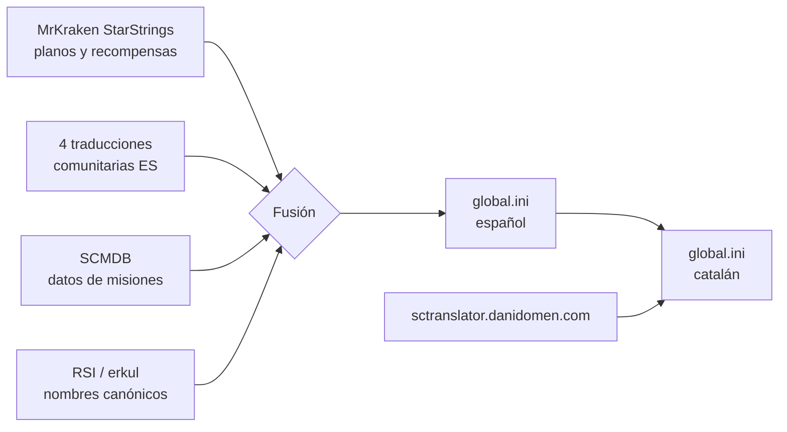
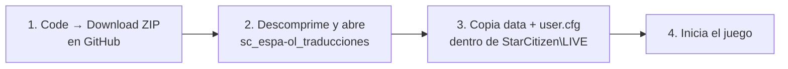
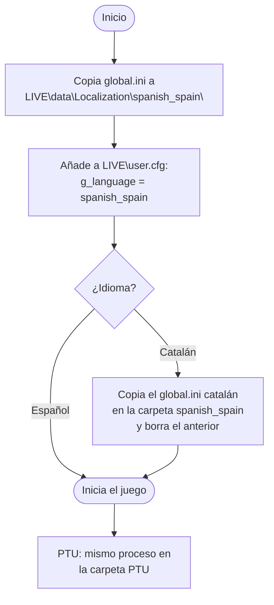
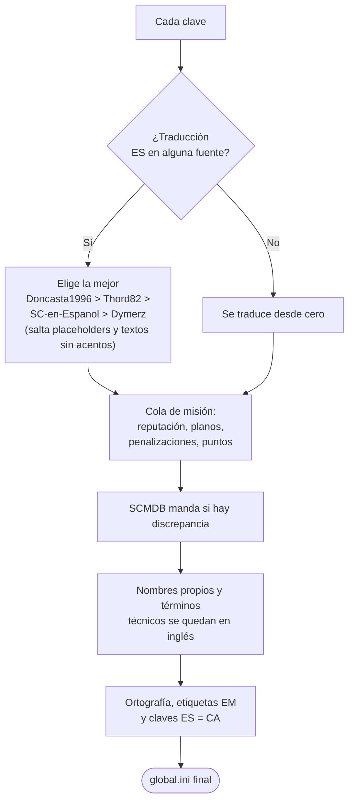

# Star Citizen - Traducción al Español/Catalán (con Blueprints/Recompensas)

Traducción no oficial de Star Citizen que combina varios proyectos comunitarios
con los **planos (blueprints) y recompensas de contratos** de
[MrKraken/StarStrings](https://github.com/MrKraken/StarStrings), todo traducido.
Es un **trabajo derivado**: existe gracias a los equipos originales
([créditos](#agradecimientos--créditos)).

## Guía de uso rápido

> Si ya tienes un `user.cfg` propio, no lo reemplaces: añade solo la línea
> `g_language = spanish_(spain)`.

## Instalación manual

Ruta de ejemplo:
`C:\Program Files\Roberts Space Industries\StarCitizen\LIVE\data\Localization\spanish_(spain)\global.ini`

El catalán (`data/Localization/catalan_(spain)/global.ini`) no es idioma
oficial, por eso se instala dentro de la carpeta `spanish_(spain)`. PTU cambia
a menudo y puede quedar desactualizada temporalmente.

## Metodología

| Regla | Resumen |
|---|---|
| Recompensas | Fuente maestra [SCMDB](https://scmdb.net); eventos sin reputación (`iasi_*`) solo muestran puntos |
| Formato de misión | Título: `<EM4>[N Rep] [BP]</EM4>`; descripción termina en reputación / planos / penalizaciones |
| Nombres | Marcas, naves, objetos, lugares, facciones y personajes en inglés; solo se traducen descriptores (`Pintura <Nave> <Nombre>`) |
| Términos técnicos | HUD, HOTAS, Gimbal, TrackIR, FOIP, IFCS… sin traducir |
| Puntuación | Español con tildes y `¿ ¡`; catalán sin `¿ ¡` |
| Actualizaciones | Solo se añaden claves nuevas; después pasan las comprobaciones finales |

## Catalán

Se genera a partir del `global.ini` español. Por clave se usa, en orden: la
traducción de [sctranslator.danidomen.com](https://sctranslator.danidomen.com/edit/es_ca/global)
o, si falta, traducción automática del pipeline.

## Agradecimientos / Créditos

- **MrKraken** — [StarStrings](https://github.com/MrKraken/StarStrings) (base en inglés y datos de planos/recompensas)
- **Jose_Pacheco** y colaboradores (Autovot, JimmyVaras, Keiran, Mornack, Speler, ZettaZ) — [Doncasta1996/Star-Citizen-Spanish](https://github.com/Doncasta1996/Star-Citizen-Spanish)
- **Thord82** y equipo Osiris-DevWorks/smart-citizen — [Thord82/Star_citizen_ES](https://github.com/Thord82/Star_citizen_ES)
- **Autovot, Keiran, Sπeler, ZettaZ, Doncasta1996, JimmyVaras, Jota_be, juancmontes, 0zzyt0, Mornack** — [SC-en-Espanol/StarCitizen-Localization-Spanish](https://github.com/SC-en-Espanol/StarCitizen-Localization-Spanish)
- **Dymerz** — [Dymerz/StarCitizen-Localization](https://github.com/Dymerz/StarCitizen-Localization)
- **Comunidad de [sctranslator.danidomen.com](https://sctranslator.danidomen.com/)** — traducción español→catalán
- **[SCMDB](https://scmdb.net)** — recompensas, planos, penalizaciones y puntos de misiones
- **[Ship Matrix de RSI](https://robertsspaceindustries.com/ship-matrix/index)** y **[erkul.games](https://www.erkul.games)** — nombres canónicos de naves, fabricantes y componentes

Si falta alguna atribución, abre un issue para corregirlo.

## Aviso legal

Proyecto de fans **no oficial**, sin afiliación con Cloud Imperium Games ni
Roberts Space Industries. "Star Citizen" y todo su contenido original son
marcas de sus respectivos dueños. Se distribuye solo con fines de localización
comunitaria, al amparo de la
[política de localización de la comunidad de CIG](https://robertsspaceindustries.com/spectrum/community/SC/forum/1/thread/star-citizen-community-localization-update).
Úsalo bajo tu propio criterio.
