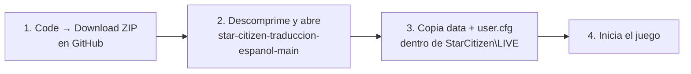
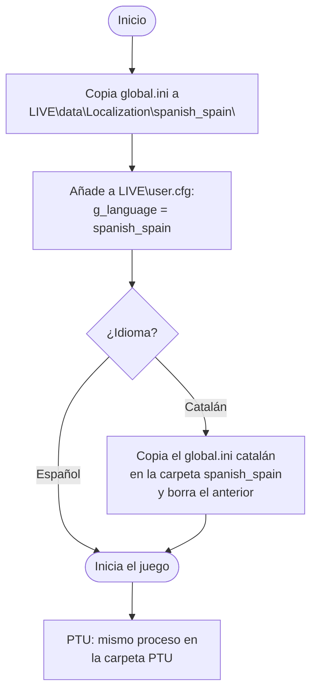
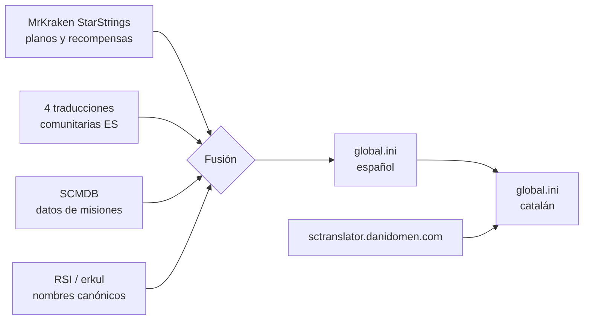
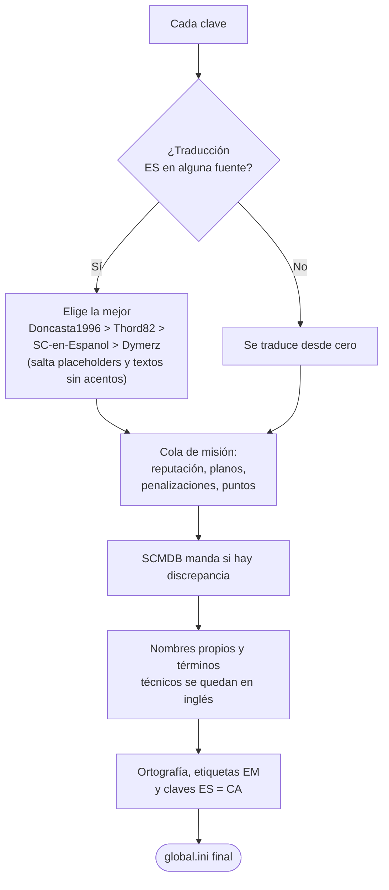

# Star Citizen en Español (España) y Catalán — `global.ini` traducido con planos y recompensas

**Traducción al español de Star Citizen (LIVE y PTU)**: un único archivo
`global.ini` con **~90.000 textos traducidos** (menús, misiones, objetos, naves,
HUD, contratos), más **planos (blueprints), reputación y recompensas de
misiones** en cada contrato. Incluye también **traducción al catalán**.
Instalación en 1 minuto: copia la carpeta `data` y `user.cfg` en `StarCitizen\LIVE`.

**[⬇️ Descargar la traducción (ZIP)](https://github.com/8Leonart/star-citizen-traduccion-espanol/archive/refs/heads/main.zip)** ·
[Ver archivo español](data/Localization/spanish_(spain)/global.ini) ·
[Ver archivo catalán](data/Localization/catalan_(spain)/global.ini) ·
[Reportar un error](../../issues) ·
[Web del proyecto](https://8leonart.github.io/star-citizen-traduccion-espanol/) ·
[Releases](../../releases)

Si te resulta útil, **dale una ⭐ al repositorio**: ayuda a que más jugadores
hispanohablantes lo encuentren.

> **English:** Unofficial **Star Citizen Spanish (Spain) + Catalan localization
> pack** (`global.ini`) with mission reputation, blueprint and reward info baked
> into contract descriptions (merged from StarStrings, community translations and
> SCMDB data). Download the ZIP, copy `data` and `user.cfg` into your
> `StarCitizen\LIVE` folder, play in Spanish.

**Búsquedas que cubre este proyecto:** Star Citizen en español · traducción de
Star Citizen al español · Star Citizen castellano · parche / mod de idioma español
para Star Citizen · descargar `global.ini` español · `spanish_(spain)` ·
`g_language = spanish_(spain)` · `user.cfg` idioma · Star Citizen español España y
Latinoamérica · Star Citizen Spanish translation / localization / language pack ·
Star Citizen català (català) · traducción 4.x LIVE y PTU · planos (blueprints),
reputación y recompensas de contratos · StarStrings en español · alternativa a
Nexus Mods / Dymerz / Doncasta1996 / Thord82 · SCMDB.

## Índice

[Guía de uso rápido](#guía-de-uso-rápido) · [Instalación manual](#instalación-manual) ·
[Qué incluye](#qué-es-este-proyecto) · [Metodología](#metodología) ·
[Catalán](#catalán) · [Preguntas frecuentes](#preguntas-frecuentes) ·
[Créditos](#agradecimientos--créditos)

## Guía de uso rápido

> Si ya tienes un `user.cfg` propio, no lo reemplaces: añade solo la línea
> `g_language = spanish_(spain)`.

## Instalación manual

Ruta de ejemplo:
`C:\Program Files\Roberts Space Industries\StarCitizen\LIVE\data\Localization\spanish_(spain)\global.ini`

El catalán (`data/Localization/catalan_(spain)/global.ini`) no es idioma
oficial, por eso se instala dentro de la carpeta `spanish_(spain)`. PTU cambia
a menudo y puede quedar desactualizada temporalmente.

## Qué es este proyecto

Traducción no oficial de Star Citizen que combina varios proyectos comunitarios
con los **planos (blueprints) y recompensas de contratos** de
[MrKraken/StarStrings](https://github.com/MrKraken/StarStrings), todo traducido.
Es un **trabajo derivado**: existe gracias a los equipos originales
([créditos](#agradecimientos--créditos)).

## Metodología

| Regla | Resumen |
|---|---|
| Recompensas | Fuente maestra [SCMDB](https://scmdb.net); eventos sin reputación (`iasi_*`) solo muestran puntos |
| Formato de misión | Título: `<EM4>[N Rep] [BP]</EM4>`; descripción termina en reputación / planos / penalizaciones |
| Nombres | Marcas, naves, objetos, lugares, facciones y personajes en inglés; solo se traducen descriptores (`Pintura <Nave> <Nombre>`) |
| Términos técnicos | HUD, HOTAS, Gimbal, TrackIR, FOIP, IFCS… sin traducir |
| Puntuación | Español con tildes y `¿ ¡`; catalán sin `¿ ¡` |
| Actualizaciones | Solo se añaden claves nuevas; después pasan las comprobaciones finales |

## Catalán

Se genera a partir del `global.ini` español. Por clave se usa, en orden: la
traducción de [sctranslator.danidomen.com](https://sctranslator.danidomen.com/edit/es_ca/global)
o, si falta, traducción automática del pipeline.

## Preguntas frecuentes

**¿Cómo pongo Star Citizen en español?**
Descarga el repositorio (Code → Download ZIP), copia la carpeta `data` y el
`user.cfg` dentro de `StarCitizen\LIVE` y arranca el juego. El `user.cfg` solo
necesita `g_language = spanish_(spain)`.

**¿Funciona con la versión LIVE actual y con PTU?**
Sí. Se actualiza con cada parche añadiendo las claves nuevas; en PTU puede ir
con algo de retraso.

**¿Hay traducción al catalán de Star Citizen?**
Sí: `data/Localization/catalan_(spain)/global.ini` (se instala en la carpeta
`spanish_(spain)`, ver [Catalán](#catalán)).

**¿Qué aporta frente a otras traducciones al español?**
Fusiona las mejores traducciones comunitarias y añade, en cada misión, la
reputación, los planos que pueden dar y las penalizaciones, validados con SCMDB.

**¿Puedo ser baneado por usarlo?**
Es el mecanismo oficial de localización comunitaria de CIG (`user.cfg` +
`global.ini`), sin modificar el cliente.

**¿Sirve para Latinoamérica (español latino)?**
Sí: el juego lo carga como `spanish_(spain)`, así que cualquier jugador
hispanohablante puede usarlo. El texto está en español neutro/castellano.

**¿Dónde se pone el `global.ini` de Star Citizen?**
En `StarCitizen\LIVE\data\Localization\spanish_(spain)\global.ini`, y en
`LIVE\user.cfg` la línea `g_language = spanish_(spain)`.

**¿Por qué aparecen textos en inglés o `@clave` en el juego?**
Porque el juego solo carga un `global.ini`: si falta una clave se ve en inglés o
como `@nombre`. Este paquete fusiona varias traducciones para cubrir todas las
claves, y se actualiza con cada parche.

**¿Es un mod, un parche o una traducción oficial?**
Es una traducción comunitaria no oficial (un "language pack"), no modifica el
cliente del juego.

**¿Cómo reporto un error de traducción?**
Abre un [issue](../../issues) con la clave y el texto correcto.

## Cómo contribuir

- Encuentras un texto mal traducido o en inglés: abre un [issue](../../issues) con
  la clave (`nombre_clave`) y la corrección.
- Las traducciones se actualizan con cada parche de Star Citizen; si falta algo
  tras una actualización, avísanos en los issues.
- Comparte el repositorio en tu comunidad (Reddit, Discord, Spectrum) para que
  más jugadores en español lo encuentren.

## Agradecimientos / Créditos

- **MrKraken** — [StarStrings](https://github.com/MrKraken/StarStrings) (base en inglés y datos de planos/recompensas)
- **Jose_Pacheco** y colaboradores (Autovot, JimmyVaras, Keiran, Mornack, Speler, ZettaZ) — [Doncasta1996/Star-Citizen-Spanish](https://github.com/Doncasta1996/Star-Citizen-Spanish)
- **Thord82** y equipo Osiris-DevWorks/smart-citizen — [Thord82/Star_citizen_ES](https://github.com/Thord82/Star_citizen_ES)
- **Autovot, Keiran, Sπeler, ZettaZ, Doncasta1996, JimmyVaras, juancmontes, Mornack** — [SC-en-Espanol/StarCitizen-Localization-Spanish](https://github.com/SC-en-Espanol/StarCitizen-Localization-Spanish)
- **Dymerz** — [Dymerz/StarCitizen-Localization](https://github.com/Dymerz/StarCitizen-Localization)
- **Comunidad de [sctranslator.danidomen.com](https://sctranslator.danidomen.com/)** — traducción español→catalán
- **[SCMDB](https://scmdb.net)** — recompensas, planos, penalizaciones y puntos de misiones
- **[Ship Matrix de RSI](https://robertsspaceindustries.com/ship-matrix/index)** y **[erkul.games](https://www.erkul.games)** — nombres canónicos de naves, fabricantes y componentes

Si falta alguna atribución, abre un issue para corregirlo.

## Aviso legal

Proyecto de fans **no oficial**, sin afiliación con Cloud Imperium Games ni
Roberts Space Industries. "Star Citizen" y todo su contenido original son
marcas de sus respectivos dueños. Se distribuye solo con fines de localización
comunitaria, al amparo de la
[política de localización de la comunidad de CIG](https://robertsspaceindustries.com/spectrum/community/SC/forum/1/thread/star-citizen-community-localization-update).
Úsalo bajo tu propio criterio.
